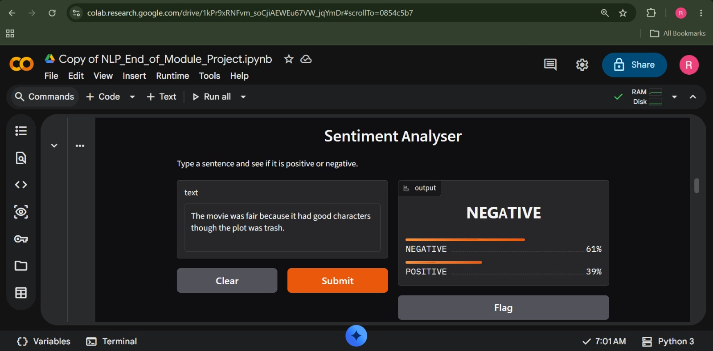
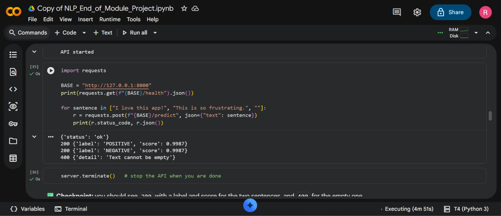
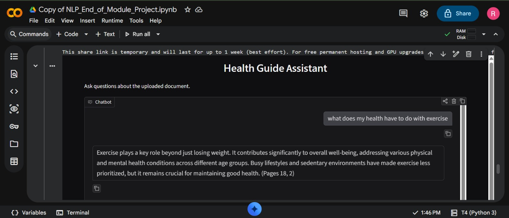

# Group NLP Project

**Course:** Applied Data Science WITI C5 — NLP End-of-Module Project  
**Deadline:** 7th November 2026, 23:59  
**Members:** Joanitah Nattabi  and Rahmah Namugwanya

---

## App 1: Sentiment Analyser

The Sentiment Analyser is an NLP application that classifies movie reviews according to their sentiment.

- **Model:** [Rahmah and Joanitah's Sentiment Analysis Model](https://huggingface.co/RahmahwithCode/rahmahandjoanitah-sentiment-model)
- **Screenshots:** `screenshot1.jpeg`, `screenshot2.jpeg`
- **Test Accuracy:** 0.9140 (91.40%)
- **Test F1 Score:** 0.9140 (91.40%)

### How to Run the API

Install the required dependencies:

```bash
pip install -r requirements.txt
```

Start the API:

```bash
uvicorn main:app --reload
```

API interactive documentation is available at:

`http://127.0.0.1:8000/docs`

### Example Prediction

- **Request:** Send `POST {"text": "I love this"}` to `/predict`.
- **Response:** `{"label": "POSITIVE", "score": 0.9921}`

### Example Predictions

| Review | Predicted Sentiment | Score |
|---|---|---|
| This movie was fantastic! The acting was brilliant. | POSITIVE | 0.9983 |
| Terrible experience, I want my money back. | NEGATIVE | 0.9973 |
| The movie was okay, but the story was predictable. | NEGATIVE | 0.9988 |

---

## App 2: Document Chatbot

The Document Chatbot uses Retrieval-Augmented Generation (RAG) to retrieve relevant information from a supplied document and answer users' questions based on its contents.

- **Document Used:** Healthy Living Guide 2020–2021
- **Screenshots:** `screenshot3.jpeg`, `screenshot4.jpeg`

### Test Results

The following five questions were used to evaluate the chatbot's ability to retrieve information and provide relevant answers from the document.

**Q1: What types of exercises can I do?**

**Answer:** Based on the information provided in the context, there are four main types of exercises:

1. **Aerobic Physical Activity:** Activities that are intense enough and last long enough to improve heart and lung fitness. Examples include walking, jogging, dancing, bicycling, basketball, soccer, and swimming.
2. **Muscle-Strengthening Activity:** Also known as resistance training, these activities help maintain or increase muscle strength, endurance, and power. Examples include using weight machines, free weights, resistance elastic bands, Pilates, and performing daily activities such as lifting children.
3. **Balance Training:** Activities that aim to improve body control and stability.
4. **Flexibility Exercises:** These include dynamic stretches performed with movement, static stretches held for several seconds or longer, passive stretching using an external force, and active stretching without an external force.

The document also mentions incorporating movement into everyday activities, such as doing squats, marching in place, jumping jacks, push-ups, or sit-ups while watching TV or during commercials. It also suggests checking schedules at gyms, yoga studios, and community centres for fitness classes and events.

**Q2: What can one do to maintain good health?**

**Answer:** One can maintain good health by eating a healthy diet, exercising regularly, keeping a healthy body weight, avoiding excessive alcohol consumption, and not smoking.

**Q3: What foods can one eat to also maintain good health?**

**Answer:** One can eat fruits and vegetables because they are rich in vitamins and minerals that contribute to maintaining good health.

**Q4: What time do lessons start at my school?**

**Answer:** I don't know, that is not in the document.

**Q5: Have I taken lunch today?**

**Answer:** I don't know, that is not in the document.

### What Broke and How We Fixed It

---

## Our Model vs the LLM

- **Latency & Speed:** Our fine-tuned DistilBERT processes inference in approximately 15–30 ms per review on GPU and 80 ms on CPU, making it roughly 10 to 20 times faster than cloud LLM API calls over HTTPS.
- **Cost:** Once fine-tuned, DistilBERT can run locally or on low-cost computing resources without recurring per-token API costs.
- **Privacy & Security:** DistilBERT can run locally without exposing sensitive user reviews or customer feedback to external third-party endpoints.
- **Offline Reliability:** DistilBERT can operate in offline environments, whereas cloud-based LLM APIs require internet connectivity.
- **Generality vs Specialisation:** LLMs provide open-ended reasoning, while our specialised DistilBERT model is optimised for sentiment classification, achieving 91.40% test accuracy.

---

## Limitations

- **Domain & Language Constraint:** The model was trained predominantly on English movie reviews (`stanfordnlp/imdb`). Its performance may decrease on non-English text, Luganda expressions, and local informal colloquialisms.
- **Sarcasm & Subtlety:** Highly sarcastic reviews, such as *"What a breathtaking waste of two hours of my life"*, can sometimes be difficult to classify correctly.
- **RAG Document Boundary:** The document chatbot is limited to the information contained in the supplied Healthy Living Guide. It may not answer questions outside the document.

---

## Who Did What

### Member A: Joanitah Nattabi (`nattabijoanitah`)

- Fine-tuned the DistilBERT sequence classification model on the IMDb dataset using Google Colab.
- Computed and validated the test metrics (Accuracy: 0.9140, F1 Score: 0.9140).
- Contributed to publishing the sentiment model on the Hugging Face Hub.
- Developed the FastAPI microservice (`main.py`) with input validation and `/health` endpoints.

### Member B: Rahmah Namugwanya

- Built the document ingestion and retrieval pipeline using `pypdf` and `sentence-transformers` over the supplied document.
- Implemented the interactive Gradio interfaces (`app.py` for Sentiment Analysis and `chatbot_app.py` for Document RAG).
- Conducted the chatbot tests and evaluated the five-question benchmark.
- Recorded and validated all four submission screenshots and structured the GitHub repository.

---

## Project Screenshots

### Sentiment Analyser





### Document Chatbot

### Document Chatbot




